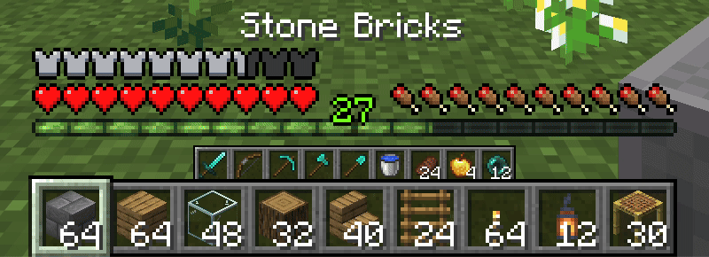
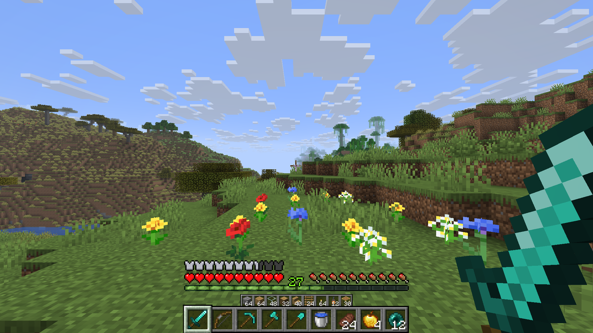
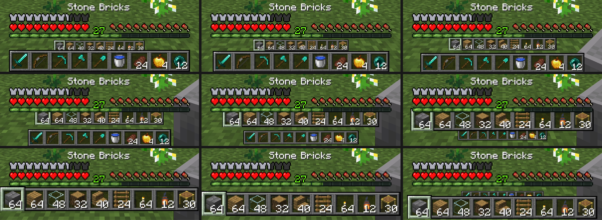
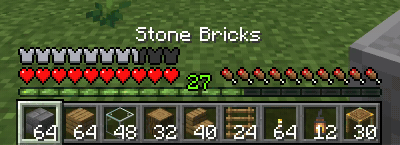

# Dual Hotbar

A second hotbar for Minecraft, made from the bottom row of your inventory and drawn at half size above the normal hotbar. **Shift + mouse wheel** swaps the two, with the items trading places in your inventory and the bars animating into each other's place. With an experimental setting, the selection can also move onto the second bar.

For Minecraft 26.1, 26.2 and 26.3, on Fabric (with Fabric API) and NeoForge. Client-only: servers don't need it.

Settings, keys, compatibility and how it works: [mods/dualhotbar/README.md](mods/dualhotbar/README.md).

The 1.10/1.11 versions are on the [`master`](https://github.com/RebelKeithy/DualHotbar/tree/master) branch.

## Screenshots

One swap, slowed down, frame by frame: the bars trade size and place as they pass each other.

With Overlap at Full, the second hotbar stays hidden behind the hotbar until you swap, and the rest of the HUD stays where vanilla puts it:

## Download

Each [release](https://github.com/RebelKeithy/DualHotbar/releases) has one jar per Minecraft version and loader, named `dualhotbar-<version>+<minecraft>-<loader>.jar`. Fabric needs [Fabric API](https://modrinth.com/mod/fabric-api); [Mod Menu](https://modrinth.com/mod/modmenu) adds a settings button but isn't required.

## Building

Needs Java 25. If `org.gradle.java.installations.paths` in `gradle.properties` doesn't point at a Java 25 on your machine, Gradle downloads one.

| Task | Command |
|---|---|
| Build every jar | `./gradlew build` → `mods/dualhotbar/versions/<target>/build/libs/` |
| Play-test a target | `./gradlew :dualhotbar:26.3-fabric:runClient` |
| Unit tests for the build logic | `./gradlew :buildSrc:test` |

Targets (`26.1-fabric` through `26.3-neoforge`) are listed in `mods/dualhotbar/gradle.properties`; the Minecraft, loader and library versions for each Minecraft release are in `minecraft/<version>.properties`. One copy of the code serves every target: [Stonecutter](https://codeberg.org/stonecutter/stonecutter) comments pick the right lines for each version, and `fabric/` and `neoforge/` packages hold loader-specific code.

## Releasing

1. Set `mod_version` in `mods/dualhotbar/gradle.properties` and commit.
2. Push a matching tag: `git tag v1.0.0 && git push origin v1.0.0`.

GitHub Actions ([`.github/workflows/build.yml`](.github/workflows/build.yml)) builds all six jars and publishes a release with them attached. Every push and pull request is built too, with the jars kept as a workflow artifact.
